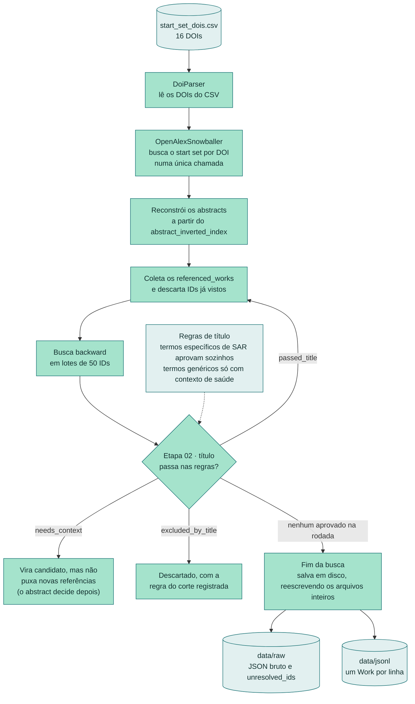
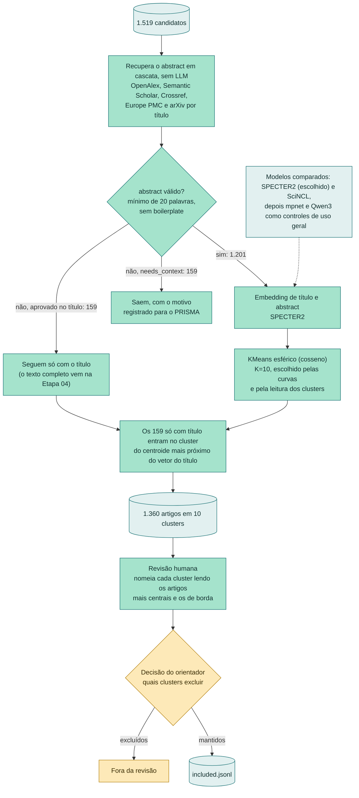
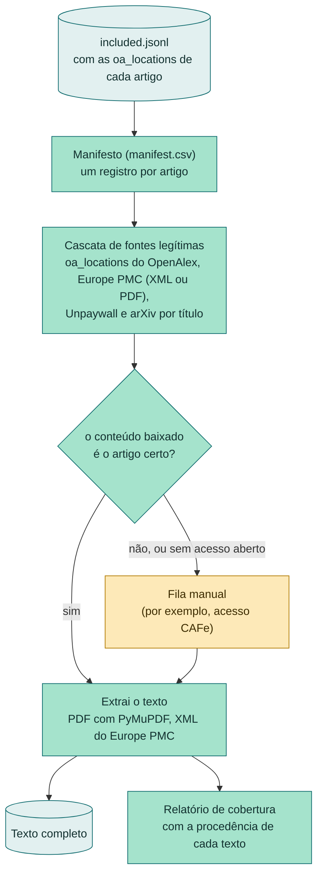
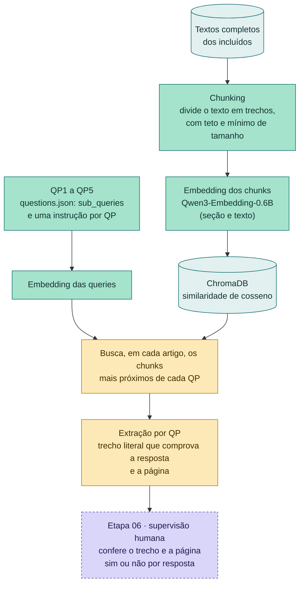

# Fluxo da pipeline de revisão por snowballing

Este documento mostra, passo a passo, como a pipeline transforma um conjunto inicial de 16 artigos em uma tabela final de análise para a revisão sobre robôs sociais e socialmente assistivos (SAR).

A ideia central é cortar e organizar em etapas: cada uma amplia, corta ou organiza o que a anterior trouxe, e as decisões que exigem julgamento (por cluster e por resposta) são humanas.

**Legenda das cores** (estado em 21/10/2026)

| Cor | Significado |
|---|---|
| 🟩 | Implementada |
| 🟨 | Em andamento ou aguardando uma decisão |
| ⬜ | Planejada |
| 🟪 | Etapa manual, feita em conjunto |

## Visão geral

```mermaid
flowchart TD
    START[("start_set_dois.csv<br/>16 DOIs")]:::data

    E1["<b>Etapa 01 · Snowballing</b><br/>busca as referências (backward)<br/>de cada rodada no OpenAlex"]:::done
    E2["<b>Etapa 02 · Corte por título</b><br/>regras regex<br/>registram a regra do corte"]:::done
    CAND[("1.519 candidatos<br/>de 17.110 artigos baixados")]:::data
    E3["<b>Etapa 03 · Abstract e clusters</b><br/>recupera abstracts, agrupa por tema<br/>e a revisão decide por cluster"]:::wip
    INC[("included.jsonl<br/>artigos dos clusters mantidos")]:::data
    E4["<b>Etapa 04 · Texto completo</b><br/>baixa e extrai o texto<br/>só dos incluídos"]:::wip
    TXT[("textos completos<br/>e relatório de cobertura")]:::data
    E5["<b>Etapa 05 · RAG por pergunta</b><br/>trecho literal e página<br/>para cada pergunta de pesquisa"]:::wip
    E6["<b>Etapa 06 · Supervisão humana</b><br/>sim ou não por resposta<br/>FEITA EM CONJUNTO"]:::joint
    E7["<b>Etapa 07 · Tabela final</b><br/>LLM e estatística em pandas"]:::todo

    START --> E1
    E1 --> E2
    E2 -->|"aprovados: suas referências<br/>viram a próxima rodada"| E1
    E2 --> CAND
    CAND --> E3
    E3 --> INC
    INC --> E4
    E4 --> TXT
    TXT --> E5
    E5 --> E6
    E6 --> E7

    classDef data fill:#e2f0f0,stroke:#0f6b6e,color:#12302f
    classDef done fill:#a5e3cc,stroke:#0f6b6e,color:#12302f
    classDef wip fill:#fde9b8,stroke:#b07a00,color:#3d2c00
    classDef todo fill:#e6e3dc,stroke:#8a8578,stroke-dasharray:4 3,color:#2b2a26
    classDef joint fill:#d9d6fa,stroke:#5a4fb0,stroke-dasharray:4 3,color:#1f1a4d
```

As perguntas de pesquisa (QP) que guiam as etapas 05 a 07:

| QP | Tema |
|---|---|
| QP1 | Características físicas e visuais do robô: forma, tamanho, materiais, cor, face |
| QP2 | Modalidades e estratégias de comunicação: fala, voz, gestos, movimento, toque, luz, som |
| QP3 | Emoção, expressividade e personalidade |
| QP4 | Métodos e instrumentos de avaliação da interação |
| QP5 | Questões em aberto e desafios não resolvidos |

## Etapas 01 e 02: snowballing e corte por título

O snowballing roda em rodadas. Em cada uma, o corte por título decide quais artigos seguem: só as referências dos aprovados viram a rodada seguinte. A busca para quando nenhuma rodada traz um artigo novo aprovado.

## Etapa 03: abstracts e clusters

Os candidatos passam por uma cascata de APIs para recuperar o abstract, sem LLM. Depois são agrupados por tema, e a decisão de incluir ou excluir é tomada por cluster, depois de uma leitura humana.

## Etapa 04: texto completo

Só os artigos incluídos têm o texto completo baixado. As fontes são todas legítimas (APIs, sem scraping), e o relatório final registra a procedência de cada texto.

## Etapa 05: RAG por pergunta

O RAG não responde às perguntas: ele recupera, em cada artigo, o trecho literal que responde a cada QP e a página, para a supervisão humana conferir.

